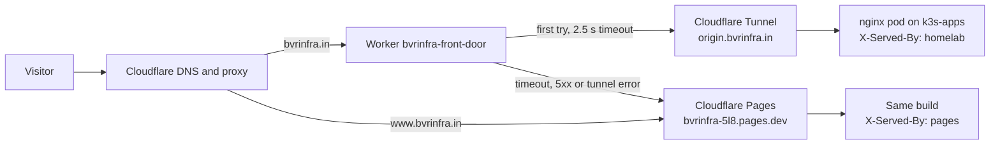
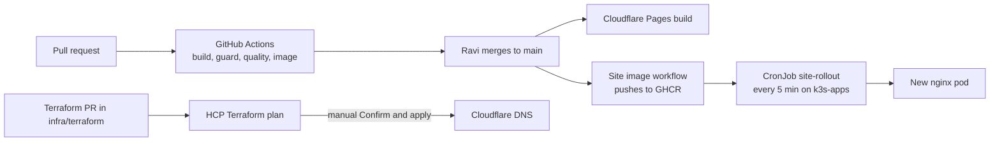
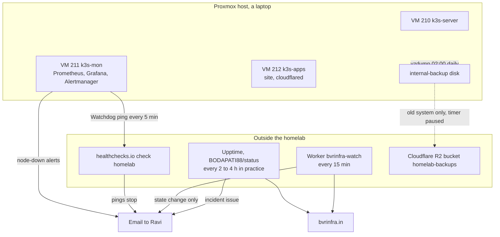

# Overview: what runs where

This page is the map. Each part links to the runbook that operates it. If you read one page first, read this one.

bvrinfra.in is Ravi Kishore's portfolio site. It is a static Astro site, built from this repo. Since 17 October 2026 it is served from a small Kubernetes cluster at home (the homelab), with the same build on Cloudflare Pages as an automatic fallback. The design rule from [ADR 0001](adr/0001-bvrinfra-architecture.md) still holds: the site must survive any homelab failure.

## How a visit is served

- The Worker asks the homelab first on every request. Nothing is cached in front of it, except fingerprinted files under `/_astro/`.
- The response header `X-Served-By` says which one answered: `homelab` or `pages`.
- `www` still goes straight to Pages. It moves behind the Worker once the apex has run a week without trouble (#101).
- The tunnel connector (cloudflared) runs inside the cluster and dials out. No port is open at home.

Details: [homelab-origin.md](homelab-origin.md). Failover test: [runbooks/failover-test.md](runbooks/failover-test.md).

## How a change reaches the site

- Site changes: [runbooks/site-deploy.md](runbooks/site-deploy.md).
- DNS changes: [runbooks/dns-terraform.md](runbooks/dns-terraform.md). Auto-apply is off.
- The two Workers (`bvrinfra-front-door`, `bvrinfra-watch`) are deployed by hand by Ravi with `npx wrangler deploy`. There is no Cloudflare token in GitHub.
- How a ticket becomes a merged PR: [runbooks/ticket-to-merge.md](runbooks/ticket-to-merge.md).

## Monitoring and backups

| Monitor | What it checks | How often | Where it alerts | Runbook |
|---|---|---|---|---|
| Upptime | Home, www and Projects pages | Scheduled every 5 min; GitHub runs it every 2 to 4 hours (#107) | An issue in `BODAPATI88/status`, which GitHub emails | [upptime.md](runbooks/upptime.md) |
| Watch Worker `bvrinfra-watch` | `https://bvrinfra.in/` | Every 15 min; down after 2 failures in a row | One email on each change of state | [watch-worker.md](runbooks/watch-worker.md) |
| Alertmanager on k3s-mon | Nodes NotReady or unreachable, node-exporter down | Fires after 2 min | Email | [monitoring-stack.md](runbooks/monitoring-stack.md) |
| healthchecks.io `homelab` | That Alertmanager is alive (the `Watchdog` ping) | Period 5 min, grace 10 min | Email when the pings stop | [monitoring-stack.md](runbooks/monitoring-stack.md) |

`[CHECK: Ravi to confirm the watch Worker is deployed and its 404 test passed (#109); this page assumes it runs.]`

Backups: [runbooks/backups-and-restore.md](runbooks/backups-and-restore.md). The new cluster is backed up every night, but a restore with the services running has **not been proven yet** (#27).

## The homelab

| Thing | Detail | Source |
|---|---|---|
| Host | Proxmox on a laptop with a dead battery. 15.4 GiB RAM, 4 CPU threads. No UPS (#85, on hold for budget). | infra-homelab `docs/homelab-build.md`, #85, #91 |
| VM 210 `k3s-server` | K3s control plane, 2 vCPU, 3 GiB. Tainted, so no workloads. | #91 |
| VM 211 `k3s-mon` | Monitoring only, 2 vCPU, 4 GiB. Taint `bvrinfra.in/role=monitoring`. | #82, #91 |
| VM 212 `k3s-apps` | Apps, 2 vCPU, 4 GiB, about 3.2 GiB allocatable after the memory reserve (#92). Runs the site and cloudflared. | #92, #101 |
| VM disks | Proxmox storage `local`, the system SSD, shared with the host OS (#94) | #91 |
| Backups | Proxmox storage `internal-backup`, a second internal disk | #27 |
| VM 200 | The old platform. Stopped, not started on boot. Its final backup is in R2. | infra-homelab `docs/homelab-build.md` |
| Admin access | Tailscale on the Proxmox host only. No admin interface is reachable from the internet (#83). SSH to the VMs is user `ravi`, keys only. | #83 |
| Code | `BODAPATI88/infra-homelab`: Terraform for the VMs, `apps/site/`, `monitoring/`, `scripts/proxmox/` | |

The VMs are built from code: Terraform in infra-homelab creates them and installs K3s. On k3s-server, `kubectl` is `sudo k3s kubectl`. From the laptop, use the kubeconfig from the build (`export KUBECONFIG=~/.kube/homelab`).

## Who owns what

From [working-agreement.md](working-agreement.md) and [AGENTS.md](../AGENTS.md).

| Who | Does | Never | May change |
|---|---|---|---|
| **Ravi** | Decides, approves, merges. Applies Terraform. Deploys Workers. Runs commands on the Proxmox host and VMs. Owns dashboards, credentials and facts. | Merges without reading the plan or the preview | Everything |
| **Claude** (Claude Code) | Code, infrastructure code, CI, Terraform code, docs. Reviews agent PRs. Runs as the hourly dispatcher on weekdays. | Pushes to `main`, holds production credentials, applies Terraform | Anything in this repo |
| **Jules / Gemini** | New articles from a supplied fact list | Touches infra, CI, styles, components or the rack data | `site/src/pages/writing/**`, `site/src/data/log.ts` |
| **Codex / ChatGPT** | Copy edits named in an issue; PR review comments | Touches layout, infra or data files | Text inside existing pages under `site/src/pages/**` |

Only Claude touches `infra/terraform/**`, `.github/**`, `site/public/_headers`, `site/src/data/stack.ts` and `AGENTS.md`. No agent receives Cloudflare, HCP Terraform or GitHub tokens.

| Part | Who applies a change |
|---|---|
| Site pages and content | Ravi merges; Pages and the image build follow |
| DNS (`infra/terraform/`) | Ravi, Confirm and apply in HCP Terraform |
| Front-door Worker (`infra/worker/`) | Ravi, `npx wrangler deploy` |
| Watch Worker (`infra/watch/`) | Ravi, `npx wrangler deploy` |
| Kubernetes manifests (infra-homelab `apps/site/`, `monitoring/`) | Ravi, `kubectl apply` or `helm upgrade` |
| Homelab VMs (infra-homelab `terraform/proxmox/`) | Ravi, `terraform apply` from the laptop |
| Upptime (`BODAPATI88/status`) | Ravi |

## Where secrets live

Names and places only. Never write a value in git, an issue, a PR or a chat. If one leaks, use [playbooks/secret-exposed.md](playbooks/secret-exposed.md).

| Secret | Where it is stored | Used by | Rotation |
|---|---|---|---|
| Cloudflare API token "Edit zone DNS" | HCP Terraform workspace `bvrinfra-dns`, env var `CLOUDFLARE_API_TOKEN`, sensitive | DNS Terraform | [dns-terraform.md](runbooks/dns-terraform.md); expires 2027-12-31 |
| HCP Terraform user token | The laptop, from `terraform login` | Running Terraform locally | `[CHECK: where Ravi keeps it and when it expires]` |
| GitHub fine-grained PAT | `BODAPATI88/status`, Actions secret `GH_PAT` | Upptime | [dns-terraform.md](runbooks/dns-terraform.md); one year from 2026-10-08 |
| Watch Worker recipient | Worker secret `ALERT_TO` | Watch Worker email | `npx wrangler secret put ALERT_TO` |
| Tunnel credentials | Kubernetes Secret `cloudflared` in namespace `site` (`credentials.json`, `tunnel-id`) | cloudflared | `[CHECK: no rotation steps written yet]`. The copies in `~/.cloudflared/` on k3s-server were deleted on 18 Oct (#105). |
| Alertmanager config | Kubernetes Secret `alertmanager-homelab` in namespace `monitoring`. Holds the Gmail app password `homelab-alertmanager`, the from and to addresses, and the healthchecks.io ping URL. | Alert email and heartbeat | infra-homelab `docs/homelab-build.md`, "Change the address or password later" |
| Grafana admin password | Kubernetes Secret `monitoring-grafana` in namespace `monitoring` | Grafana login | Reset with `grafana cli admin reset-admin-password` to the Secret's value (#82) |
| R2 access keys | `/etc/infra-homelab/r2.env` on the Proxmox host, root only | `offsite-r2.sh` | Account API token with a 1-year TTL (infra-homelab `docs/homelab-build.md`) |
| K3s join token | `token:` in `/etc/rancher/k3s/config.yaml` on the VMs; Terraform `random_password.k3s_token`; cloud-init snippets `/var/lib/vz/snippets/k3s-k3s-*.yaml` on the host | Nodes joining the cluster | [k3s-token-rotation.md](runbooks/k3s-token-rotation.md). Treated as exposed since 17 Oct (#95). |
| Proxmox root password | Ravi | Host console, Terraform from Windows | `[CHECK: rotation not written]` |
| Proxmox API token `terraform@pve!homelab` | Ravi, passed as `PROXMOX_VE_API_TOKEN` at run time | Homelab Terraform | `[CHECK: expiry and rotation not written]`. Old `root@pam` tokens are listed for review in infra-homelab `docs/homelab-build.md`. |
| Homelab Terraform variables | `terraform.tfvars` on the laptop, git-ignored | Homelab Terraform | n/a |
| Cloudflare account recovery codes | A password manager ([domain.md](runbooks/domain.md)) | Account recovery | n/a |
| GitHub recovery codes | `[CHECK: where they are kept today]`; planned for the vault (#105), with the vault's own codes offline | Account recovery | n/a |

A single break-glass vault outside the homelab is planned but not set up yet (#105, on hold). Until then, these secrets are spread across the places above. `[CHECK: Ravi to confirm whether any of them is already in a vault.]`

## Repos

| Repo | What | Agent access |
|---|---|---|
| `BODAPATI88/bvrinfra` (this one) | Site, DNS Terraform, Workers, docs | Agents through their own GitHub app |
| `BODAPATI88/infra-homelab` | Homelab VMs, Kubernetes manifests, monitoring, Proxmox scripts, `docs/homelab-build.md` | Claude in interactive sessions only; the dispatcher never touches it |
| `BODAPATI88/status` | Upptime and the status page at status.bvrinfra.in | Ravi |
