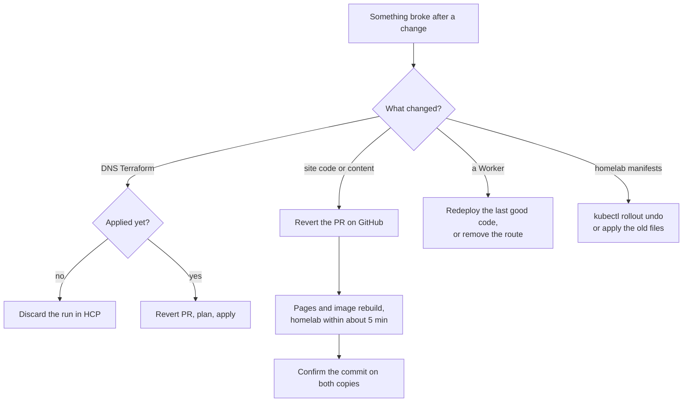

# Playbook: a bad deploy or a bad merge

## When to use it

- A merge to `main` broke a page, the layout or the content on the live site.
- A check is red on `main` after a merge.
- A merged PR said something untrue on the site (a wrong fact, a claim ahead of what runs).
- A DNS plan in HCP Terraform wants to change something nobody meant to change.
- A Worker deploy broke the site.

## Decision path



## First checks

1. **Which commit is live?** See [site-deploy.md](../runbooks/site-deploy.md#which-version-is-live):
   ```bash
   curl -s https://bvrinfra.in/ | grep -oE 'bvrinfra/commit/[0-9a-f]{40}' | head -1
   curl -sI https://bvrinfra.in/ | grep -i x-served-by
   ```
2. **Which PR brought it?** `git log --oneline origin/main | head`. The merge commit names the PR.
3. **Is it on both copies?** Check `origin.bvrinfra.in` and `bvrinfra-5l8.pages.dev` separately. The apex shows the homelab copy when the homelab is up.
4. **Is anything still running?** A red `Site image` run means the homelab still serves the previous image. A failed Pages build means Pages still serves the previous build.

## The fix

### Site code or content: revert

`main` is protected, so a revert is a PR like any other.

1. On GitHub, open the merged PR → **Revert**. This opens a new PR.
2. First line of its description: `Refs #<original issue>`. Say what broke.
3. Wait for `build` and `guard`. Ravi merges.
4. Pages rebuilds. The `Site image` workflow pushes a new `main` image, and `site-rollout` picks it up within 5 minutes.

Then fix the original change on a new branch and PR.

**Faster, for the homelab copy only, if the site is badly broken.** `[CHECK: untested.]` Suspend the rollout CronJob and pin the last good image tag, so the CronJob doesn't restart it every 5 minutes:

```bash
kubectl -n site patch cronjob site-rollout -p '{"spec":{"suspend":true}}'
kubectl -n site set image deployment/site nginx=ghcr.io/bodapati88/bvrinfra:sha-<good commit>
```

Undo both after the revert is merged: set the image back to `ghcr.io/bodapati88/bvrinfra:main` and set `suspend` to `false`. Pages has its own rollback in the dashboard (Deployments → an older deployment). `[CHECK: Pages rollback not used on this project yet.]`

### A false claim on the site

Same revert, or a small fix PR. Never move a rack unit's status in `site/src/data/stack.ts` ahead of what runs (AGENTS.md, "Rack honesty"). For an article, correct it in place with a dated correction note, as #107 did.

### DNS

- **Not applied yet:** HCP Terraform → `bvrinfra-dns` → Runs → the run → **Discard**. Nothing reached Cloudflare.
- **Applied:** revert the PR, read the new plan, and Confirm & apply. Every record has `prevent_destroy`, so a plan can't delete a record by accident.
- **A plan changes something nobody touched:** someone edited the dashboard. See [dns-terraform.md](../runbooks/dns-terraform.md#if-a-plan-wants-to-change-something-you-didnt-touch).

### A Worker

- **Front door broke the site:** remove the `bvrinfra.in/*` route first ([../homelab-origin.md](../homelab-origin.md#way-back)). Visitors go straight to Pages.
- Then redeploy the last good code from a clean checkout:
  ```bash
  git checkout <good commit> -- infra/worker
  cd infra/worker && npx wrangler deploy
  ```
  Put the route back after checking. Cloudflare also keeps earlier Worker versions in the dashboard. `[CHECK: whether Ravi prefers the dashboard rollback.]`
- **Watch Worker:** the same, from `infra/watch/`.

### Homelab manifests

```bash
kubectl -n site rollout undo deployment/site
kubectl -n site rollout status deployment/site
```

Or apply the previous files from infra-homelab: `git checkout <good commit> -- apps/site && kubectl apply -k apps/site/`.

## Confirm it's fixed

- The live commit (above) is the revert commit or the good one, on both copies.
- `build` is green on `main`.
- The broken page loads in a browser.
- If you suspended the CronJob, it is resumed and the image is `:main` again:
  ```bash
  kubectl -n site get cronjob site-rollout -o jsonpath='{.spec.suspend}{"\n"}'     # false
  kubectl -n site get deploy site -o jsonpath='{.spec.template.spec.containers[0].image}{"\n"}'
  ```

## Who to tell and where to record it

- Tell Ravi. He merges the revert.
- Comment on the original issue (reopen it if it was closed) in the `agent-update` format from [AGENTS.md](../../AGENTS.md#report-on-the-ticket): what broke, from when to when, the revert PR, and what the real fix will be.
- If an agent's PR caused it, the review step missed it. Note what the Merge standard should have caught.
