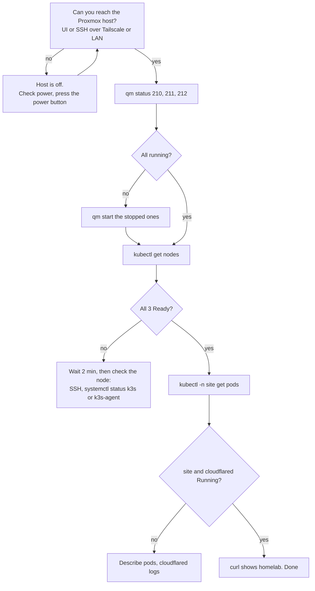

# Playbook: the homelab is down, or the power was cut

## When to use it

- `curl -sI https://bvrinfra.in/` shows `x-served-by: pages` for more than a few minutes.
- A healthchecks.io DOWN email for the check `homelab`: Alertmanager has stopped pinging, so the whole homelab, or the monitoring node, is down.
- An Alertmanager email for `KubeNodeNotReady`, `KubeNodeUnreachable` or `NodeExporterDown`.
- The power went off at home.

The site itself stays up: the Worker serves the Pages copy. So this is not an emergency for visitors. It is one for backups and monitoring, which stop while the host is off.

## What happened before

| Date | What | Recovery |
|---|---|---|
| 13 Oct, 10:20 | Host went down with no shutdown in the logs; [Likely] a power blip | Stayed off until 16:49 |
| 17 Oct, about 20:00 IST | Power cut; "system shutdown due to poweroff" | Automatic once power returned: host up, VMs started, all 3 nodes Ready and monitoring back in about 11 minutes. No alert was sent, because alerting ran on the VMs that were down. That gap is now covered by the heartbeat (#97). |

The host is a laptop with a dead battery and no UPS. The UPS is on hold for budget (#85). `[CHECK: BIOS power-on after AC loss; it is likely on, because the host came back by itself on 17 Oct, but nobody has looked in the BIOS yet (#85).]`

## Decision path



## First checks

1. **Is the host on?** Try the Proxmox UI or SSH to the host over Tailscale (phone or laptop). If Tailscale shows the host offline and the UI doesn't load from the home network either, the host is off. Someone has to be at the house.
2. **The VMs.** On the Proxmox host, as root:
   ```bash
   qm status 210; qm status 211; qm status 212
   uptime                              # how long the host has been up
   ```
3. **The cluster.** From the laptop with the homelab kubeconfig, or on k3s-server with `sudo k3s kubectl`:
   ```bash
   kubectl get nodes
   kubectl get pods -n site -o wide
   kubectl get pods -n monitoring -o wide
   ```
4. **The site path.**
   ```bash
   curl -sI https://origin.bvrinfra.in/ | grep -iE '^HTTP|x-served-by'
   kubectl -n site logs deploy/cloudflared | grep -i "registered tunnel connection"
   ```

## The fix

- **Host off:** restore power and press the power button. Then wait. On 17 Oct everything came back in about 11 minutes with no help.
- **A VM stopped:** `qm start <vmid>`. VMs 210 to 212 should start on boot. `[CHECK: onboot is set for 210, 211 and 212.]`
- **A node NotReady after the VM runs:** SSH to it as `ravi` and check `sudo systemctl status k3s` (k3s-server) or `sudo systemctl status k3s-agent` (k3s-mon, k3s-apps). Restart it with `sudo systemctl restart k3s-agent`. Running pods keep running.
- **site or cloudflared not Running:** `kubectl -n site describe pod <pod>` and `kubectl -n site logs deploy/cloudflared`. The tunnel uses HTTP/2, because QUIC dropped every few seconds from home (#101). The Secret `cloudflared` must exist in namespace `site`.

### After a power cut, also

1. **SSH host keys.** On 17 Oct all three VMs booted with a new cloud-init identity and got new SSH host keys. If SSH warns that a host key changed, don't just accept it. Check the key through the guest agent first, as was done on 17 Oct, then remove the old entry with `ssh-keygen -R <host>`. `[CHECK: the exact guest agent command used on 17 Oct to read the host key, for example qm guest exec.]`
2. **Last night's backup.** If the host was off at 02:00, there is no backup for that night. Check Datacenter → Backup and the Task History, and run one by hand if needed ([backups-and-restore.md](../runbooks/backups-and-restore.md#take-a-backup-now)).
3. **Monitoring.** Check the pods in `monitoring` restarted cleanly, and the healthchecks.io check is green again ([monitoring-stack.md](../runbooks/monitoring-stack.md)).
4. **Memory.** k3s-apps holds onto memory it has touched. If the host was under memory pressure before, check host available memory in the Proxmox UI.

## Confirm it's fixed

```bash
kubectl get nodes                                         # 3 Ready
curl -sI https://bvrinfra.in/ | grep -i x-served-by       # homelab
```

- healthchecks.io sends an UP email, and the `homelab` check is green.
- Alertmanager sends "resolved" emails for any node alerts.

## Who to tell and where to record it

- Tell Ravi. Only he can reach the host physically or run commands on it.
- Record each power loss on #85 (date, time, how it came back, minutes to recovery). That record is the case for the UPS.
- Record anything else on the related issue in the `agent-update` format from [AGENTS.md](../../AGENTS.md#report-on-the-ticket):
  ```
  <!-- agent-update -->
  **Update: <who>, homelab down <date>**
  - Did: <down from to, in UTC or IST, cause, how it came back>
  - Next: <missed backup, key check, or "nothing">
  - Needs from Ravi: <one line, or "nothing">
  - PR: none
  ```
