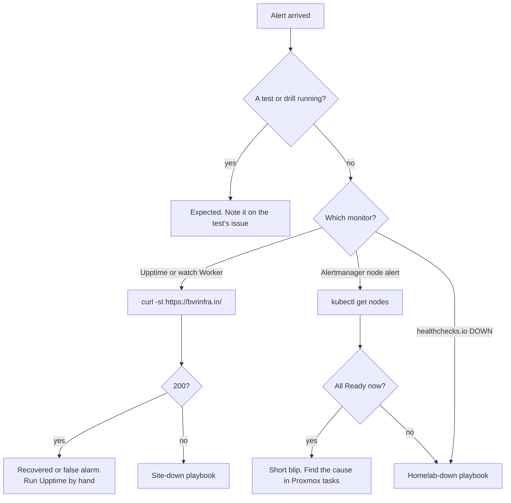

# Playbook: a monitor alert arrived

## When to use it

Any alert email or incident arrives, and you need to know what it means and which playbook to follow. Start by reading which monitor sent it.

| Alert | Sent by | What it means |
|---|---|---|
| An issue opened in `BODAPATI88/status`, with a GitHub email | Upptime | One of the 3 URLs failed when Upptime last ran. It runs every 2 to 4 hours, so the failure can be hours old. |
| "bvrinfra.in is down" | Watch Worker `bvrinfra-watch` | 2 checks in a row failed, 15 minutes apart. A Pages answer counts as up, so this means visitors can't load the site. |
| "bvrinfra.in is back up" | Watch Worker | The first good check after a down. |
| Firing: `KubeNodeNotReady`, `KubeNodeUnreachable` | Alertmanager on k3s-mon | A node has been NotReady or unreachable for 2 minutes |
| Firing: `NodeExporterDown` | Alertmanager | A VM stopped or hung for 2 minutes |
| Resolved: the same names | Alertmanager | It recovered |
| DOWN for the check `homelab` | healthchecks.io | Alertmanager's `Watchdog` pings stopped for more than 15 minutes: the host, all VMs, or k3s-mon is down |
| UP for the check `homelab` | healthchecks.io | The pings are back |
| Other alerts from the chart | Alertmanager | Default kube-prometheus-stack rules. `[CHECK: which other rules fire to email in practice; none are documented yet.]` |

Telegram alerts are planned (#96), not set up.

## Decision path



## First checks

1. **Is a test running?** These cause alerts on purpose: the failover test (`qm shutdown 212`), the node-down test, the heartbeat test, the restore drill, a capacity test. Check the open issues for one dated today.
2. **When did it happen?** Read the time in the alert. Upptime issues can be hours behind. Compare with now.
3. **Is the site up now?**
   ```bash
   curl -sI https://bvrinfra.in/ | grep -iE '^HTTP|x-served-by'
   ```
4. **Is the cluster up now?**
   ```bash
   kubectl get nodes
   ```
5. **Proxmox task history.** On the host, the node's Task History shows any `qm shutdown`, `qm start` or `vzdump` around the alert time.

## The fix

| Situation | Go to |
|---|---|
| The site doesn't load | [site-down.md](site-down.md) |
| The site loads from Pages, a node is down, or healthchecks.io says DOWN | [homelab-down-or-power-cut.md](homelab-down-or-power-cut.md) |
| Alerts arrive but nothing is wrong | [monitoring-stack.md](../runbooks/monitoring-stack.md) to check the rules and routes |
| An alert should have come but didn't | [monitoring-stack.md](../runbooks/monitoring-stack.md) step 4, and the receiver's credentials |
| Upptime red, site fine | [upptime.md](../runbooks/upptime.md): check which URL failed and whether `GH_PAT` expired |
| Watch Worker silent or noisy | [watch-worker.md](../runbooks/watch-worker.md): read its Logs in the dashboard; each run logs `check`, `status`, `fails`, `alert` |

## Confirm it's fixed

- The matching "resolved", "back up" or UP message arrived.
- The Upptime incident issue closed. Run Upptime by hand to close it now rather than in a few hours.
- `kubectl get nodes` shows 3 Ready, and `curl` shows `x-served-by: homelab`.

## Who to tell and where to record it

- Tell Ravi if the alert was real, or if a monitor misbehaved.
- Record a real outage on the related issue (power cuts on #85) in the `agent-update` format from [AGENTS.md](../../AGENTS.md#report-on-the-ticket), with the alert's time, the cause and the time it recovered.
- A false or missing alert is a bug in the monitoring. Open an issue for it, like #93 and #97 were.
