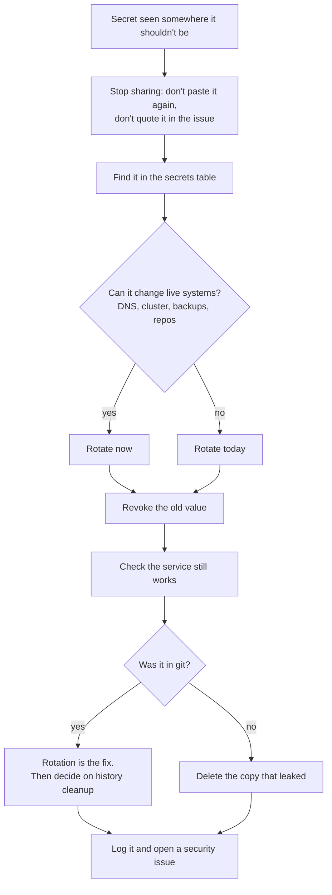

# Playbook: a secret was exposed

## When to use it

A token, password, key, ping URL or credentials file was seen by someone or something that shouldn't have it. For example:

- printed in a terminal and pasted into a chat, as happened with the K3s join token on 17 Oct (#95);
- committed to git, even on a branch, even if deleted later;
- pasted into an issue, PR, comment or screenshot;
- left in a file in a place others can read.

Treat "maybe seen" as seen. Rotating is cheap; guessing wrong is not.

## Decision path



## First checks

1. **Which secret?** Find it by name in [overview.md](../overview.md#where-secrets-live). That table says where it is stored and what uses it.
2. **Where did it go?** Chat, git, an issue, a screenshot. Note the time.
3. **What can it do?** For example: the Cloudflare token edits DNS for bvrinfra.in; the R2 keys can read and delete the off-site backups; the healthchecks.io ping URL lets anyone fake "all fine"; the K3s join token lets a machine join the cluster.
4. **In git?** List the commits that added or removed it, without printing the diff:
   ```bash
   git log --all -S '<first few characters>' --oneline | head
   ```
   Run that on your own machine only, and clear the terminal and shell history after.

## The fix: rotate, then revoke

Rotate first. Deleting the leaked copy does not make the old value safe.

| Secret | How to rotate |
|---|---|
| Cloudflare API token "Edit zone DNS" | [dns-terraform.md](../runbooks/dns-terraform.md#rolling-the-token): Roll in Cloudflare, replace `CLOUDFLARE_API_TOKEN` in HCP, run a plan-only run |
| GitHub PAT `GH_PAT` (status repo) | Create a new fine-grained PAT with the same scope, replace the Actions secret, delete the old PAT, run Uptime by hand ([upptime.md](../runbooks/upptime.md)) |
| K3s join token | [k3s-token-rotation.md](../runbooks/k3s-token-rotation.md) |
| Gmail app password `homelab-alertmanager` | Delete it in the Google account, create a new one, rebuild the Secret `alertmanager-homelab` (infra-homelab `docs/homelab-build.md`, "Change the address or password later"), then run the node-down test ([monitoring-stack.md](../runbooks/monitoring-stack.md#tests)) |
| healthchecks.io ping URL | `[CHECK: how to get a new ping URL for the check in healthchecks.io]`, then rebuild `alertmanager-homelab` (infra-homelab "Heartbeat" section) |
| R2 access keys | Create a new R2 Account API token (Object Read & Write, `homelab-backups` only), put it in `/etc/infra-homelab/r2.env`, delete the old token in Cloudflare |
| Tunnel credentials (`cloudflared` Secret) | `[CHECK: no procedure yet; likely a new tunnel with cloudflared tunnel create, a new Secret, and origin_tunnel_id updated in HCP]` |
| Grafana admin password | Change the value in the Secret `monitoring-grafana`, then reset Grafana to it ([monitoring-stack.md](../runbooks/monitoring-stack.md#fixes)) |
| Proxmox root password, Proxmox API token | `[CHECK: no procedure written]` |
| Watch Worker `ALERT_TO` | Not a credential, but private: `npx wrangler secret put ALERT_TO` |

Rules while you do it:

- Never put the old or new value in the issue, the PR, a commit or a chat.
- Read secrets in with `read -rs`, check only the length with `echo ${#VAR}`, and `unset` it after.
- Inspect K3s config with `grep -v token`, never `cat` or `tail`.

### If it was in git

Rotation is the fix. Removing a value from history does not un-expose it: forks, clones and caches keep it. After rotating, Ravi decides whether to rewrite history. The old `bvrinfra-site` repo was archived without a history rewrite, and that risk was accepted (ADR 0001).

## Confirm it's fixed

- The service that uses the secret works with the new value (a plan-only run, a green Upptime run, a test alert, `kubectl get nodes`, `Off-site OK`).
- The old value is refused or deleted at the provider.
- The leaked copy is gone where you control it (a file on a VM, a branch).

## Who to tell and where to record it

- Tell Ravi straight away. He holds the credentials and does the rotation.
- Open an issue with `type:security`, like #95. Say what leaked, where and when, by **name only**.
- Add a row to the rotation log in [dns-terraform.md](../runbooks/dns-terraform.md#rotation-log): date, what, why.
- Post the result on the issue in the `agent-update` format from [AGENTS.md](../../AGENTS.md#report-on-the-ticket), with no values.
- After the vault exists (#105), store the new value there.
