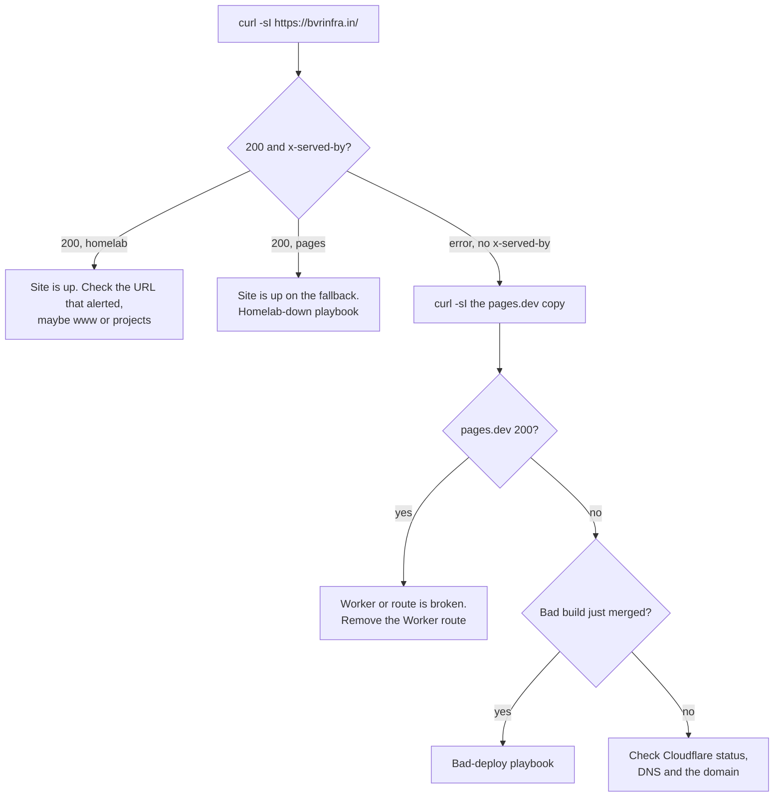

# Playbook: the site is down

## When to use it

- A monitor says bvrinfra.in is down: an Upptime incident issue, or a "bvrinfra.in is down" email from the watch Worker.
- Someone reports the site doesn't load.

If the site loads but is served by Pages (`x-served-by: pages`), the site is **up**. That is the homelab being down, not the site: use [homelab-down-or-power-cut.md](homelab-down-or-power-cut.md).

## Decision path



## First checks

From any machine, outside the home network if you can (phone on mobile data):

```bash
curl -sI https://bvrinfra.in/ | grep -iE '^HTTP|x-served-by'
curl -sI https://www.bvrinfra.in/ | grep -iE '^HTTP'
curl -sI https://bvrinfra.in/projects/ | grep -iE '^HTTP|x-served-by'
curl -sI https://bvrinfra-5l8.pages.dev/ | grep -iE '^HTTP'
curl -sI https://origin.bvrinfra.in/ | grep -iE '^HTTP|x-served-by'
```

| Result | Meaning |
|---|---|
| Apex `200`, `homelab` | Up. Check the exact URL that alerted, and the alert's time: Upptime can be hours late. |
| Apex `200`, `pages` | Up on the fallback. The homelab is down or slow. |
| Apex error or timeout, with no `x-served-by` | The Worker didn't answer properly, or Cloudflare itself is failing. |
| `pages.dev` error | The Pages copy is broken. A bad build, or a Pages problem. |
| `www` error, apex fine | `www` goes straight to Pages, not through the Worker. Look at Pages and the `www` record. |

Also check, if the above makes no sense:

```bash
dig NS bvrinfra.in +short        # carlane.ns.cloudflare.com and kanye.ns.cloudflare.com
dig bvrinfra.in +short           # Cloudflare's proxy addresses; don't paste them anywhere
```

- Cloudflare's own status page: [cloudflarestatus.com](https://www.cloudflarestatus.com).
- The domain expires 2029-04-24 and auto-renew is off ([domain.md](../runbooks/domain.md)).
- A pending HCP Terraform run that changed DNS: HCP → `bvrinfra-dns` → Runs.

## The fix

**Worker broken, Pages fine.** Fastest way back, about 1 minute: Cloudflare dashboard → Workers & Pages → `bvrinfra-front-door` → Settings → Triggers (or Domains & Routes), and remove the `bvrinfra.in/*` route. Visitors go straight to Pages, as before #101. Then fix the Worker in a PR and redeploy with `npx wrangler deploy` from `infra/worker/`, and put the route back. Details in [../homelab-origin.md](../homelab-origin.md#way-back).

**Pages broken after a merge.** Use [bad-deploy-or-merge.md](bad-deploy-or-merge.md). While the homelab is up, the apex still serves the homelab copy, so check which one is broken.

**DNS wrong.** Compare the records in Cloudflare with `infra/terraform/main.tf`. Fix through Terraform, not the dashboard: [dns-terraform.md](../runbooks/dns-terraform.md). In a real emergency a dashboard edit is allowed, but put it into code the same day, or the next plan will undo it.

**Cloudflare outage.** Nothing to do but wait and record it. Every path to the site goes through Cloudflare.

## Confirm it's fixed

```bash
curl -sI https://bvrinfra.in/ | grep -iE '^HTTP|x-served-by'       # 200, homelab or pages
curl -sI https://www.bvrinfra.in/ | grep -iE '^HTTP'               # 200
```

Open the site in a browser on the phone (mobile data). Then run Upptime by hand ([upptime.md](../runbooks/upptime.md)) so the status page and its incident issue close now, not in a few hours. The watch Worker sends a "back up" email after its next good check.

## Who to tell and where to record it

- Tell Ravi. He owns the dashboards and is the only one who can deploy the Worker or apply DNS.
- Record it on an issue: the Upptime incident issue in `BODAPATI88/status` if there is one, and a new or existing issue in this repo with the times (UTC), what was checked and what fixed it. Use the format from [AGENTS.md](../../AGENTS.md#report-on-the-ticket):
  ```
  <!-- agent-update -->
  **Update: <who>, <status>**
  - Did: <what was down, from when to when (UTC), what fixed it>
  - Next: <follow-up, or "nothing">
  - Needs from Ravi: <one line, or "nothing">
  - PR: <link, or "none">
  ```
- An outage visitors saw may deserve a post-mortem, like the September 2026 one. Ravi decides.
