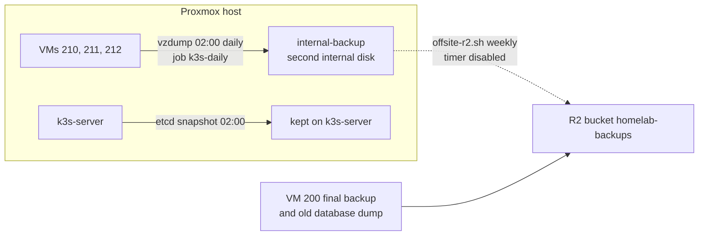
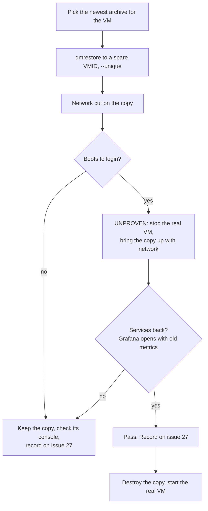

# Runbook: backups and the restore drill

> **Status, 18 October 2026:** the new cluster (VMs 210, 211, 212) is backed up every night, but **no restore of it has been proven**. The services-running restore drill is set for 19 Oct (#27). Until it passes, treat every restore step below marked **UNPROVEN** as a plan, not a procedure. Rack unit U5 on the site stays Building until then.

Source of truth for setup: infra-homelab `docs/homelab-build.md`, sections "Backups" and "Backups stage 2". This page says what exists, how to check it, and how to restore.

## What is backed up



| What | When | Kept | Where | Proven |
|---|---|---|---|---|
| Whole VMs 210, 211, 212 (Proxmox job `k3s-daily`, snapshot mode, zstd) | Daily 02:00 | 7 daily, 4 weekly | `internal-backup` (`/mnt/internal-backup`) | Backup: yes, first manual run 15 Oct. **Restore: no.** |
| K3s etcd snapshot | Daily 02:00 | 7 | Inside k3s-server | `[CHECK: snapshot listing not yet recorded]` |
| VM 200 (old platform), final backup | Once, 10 Oct | Kept | `internal-backup` and R2 `vzdump/200/` | Yes: restore drill from local disk 10 Oct, from R2 13 Oct. Booted; services not checked. |
| Old database dump | Once, 10 Oct | Kept | `internal-backup` and R2 `archive/` | Checksum verified 13 Oct |

What is **not** covered:

- The new cluster has no off-site copy. Ravi decided on 15 Oct that the VMs are rebuilt from Terraform, and off-site copies wait for application data. The `offsite-r2.timer` is disabled (#81). The monitoring data on k3s-mon is application data since 16 Oct, so this decision may need revisiting. `[CHECK: Ravi to decide whether k3s-mon now needs an off-site copy.]`
- `internal-backup` is in the same host. A host failure, theft or fire loses both the VMs and their backups.
- The host has no UPS. A power cut during 02:00 means no backup that night (#85).
- The USB drive is personal and never a backup target.

## Check the backups

On the Proxmox host, as root:

```bash
pvesh get /cluster/backup/k3s-daily --output-format yaml     # schedule 02:00, vmid 210,211,212, enabled 1
ls -lt /mnt/internal-backup/dump/ | head -10                 # newest archives first
```

In the Proxmox UI: Datacenter → Backup → `k3s-daily`; and the node's Task History for last night's `vzdump` task, which must end OK.

On k3s-server:

```bash
sudo k3s etcd-snapshot ls
```

## Take a backup now

Before risky work (an upgrade, a token rotation), take a fresh backup. This exact command ran on 15 Oct and ended `Backup job finished successfully`:

```bash
vzdump 210 211 212 --storage internal-backup --mode snapshot --compress zstd
```

Or Datacenter → Backup → `k3s-daily` → **Run now**.

If the job does not exist, create it with `BACKUP_STORAGE=internal-backup ./scripts/proxmox/backup-job.sh 210 211 212` from an infra-homelab checkout on the host.

## Restore a VM: the drill



### Proven part: restore and boot with the network cut (10 Oct, VM 200)

This passed on 10 Oct for VM 200: restored as VM 299 with `qmrestore --unique`, network cut (`link_down=1`), memory 2 GiB, booted to the Ubuntu login prompt, then destroyed.

```bash
ls -t /mnt/internal-backup/dump/ | grep -- '-211-' | head -3      # newest archive for VM 211, for example
qmrestore /mnt/internal-backup/dump/<archive> 299 --unique
qm set 299 --net0 <the same net0 line, with link_down=1>
qm start 299
```

`[CHECK: the exact qmrestore and qm set commands used on 10 Oct; they are not written down in either repo.]` VM 299 is the spare ID used in both earlier drills. Check it is free first with `qm status 299`.

From R2 there is a script that does all of this, including the download and checksum, and waits up to 15 minutes for the guest agent:

```bash
r2-restore-drill.sh 200 299
```

It prints a `RESULT` line. Paste that line on #27. Note it only works for VMs that have a copy in R2, which today is VM 200 only.

### UNPROVEN part: the services come back (planned 19 Oct)

Plan from #27, to be replaced by the real steps after the drill:

1. Take a fresh backup of k3s-mon (above).
2. Stop the real k3s-mon: `qm shutdown 211`.
3. Restore k3s-mon's newest backup to a spare VMID and start it with the network up. `[CHECK: how the copy gets k3s-mon's address and node identity, given --unique gives it a new MAC.]`
4. Check the node rejoins: `kubectl get nodes` shows `k3s-mon` Ready.
5. Check the monitoring pods run on it, open Grafana by port-forward ([monitoring-stack.md](monitoring-stack.md)), and check that metrics from before the backup are still there.
6. Destroy the copy, start the real VM 211, check all three nodes are Ready.
7. Record the times and results on #27. The PR that records this moves rack U5 to Live.

Note that k3s-mon being down raises the node-down alert after 2 minutes. That is expected during the drill.

## Restore a VM for real

If a VM is lost (not a drill): restore its newest archive to its **own** VMID once the broken VM is gone, start it, and check `kubectl get nodes`. `[CHECK: never done for VMs 210 to 212. Rebuilding with Terraform from infra-homelab may be the better path for k3s-server and k3s-apps, which hold no application data; Ravi to decide.]`

## Rules

- A backup without a passed restore test doesn't count as a backup (ADR 0001, D4).
- Never write server backups to the USB drive.
- Never paste the R2 keys from `/etc/infra-homelab/r2.env`. Check its shape without printing values, as in #81:
  ```bash
  awk '{split($1,a,"="); print NR": "a[1]" — "NF" word(s)"}' /etc/infra-homelab/r2.env
  ```
- Keep test runs away from 01:30 to 03:00.
