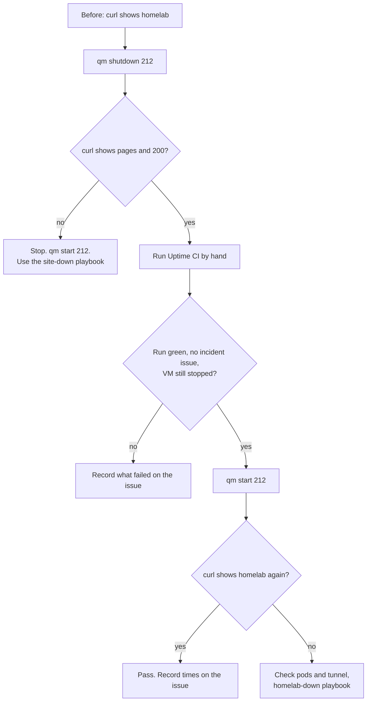

# Runbook: failover test

Proves that bvrinfra.in keeps loading from Cloudflare Pages while the homelab is down, and that the outside monitor stays green. This is the procedure that passed on 18 October 2026 (#101). Setup and the design are in [../homelab-origin.md](../homelab-origin.md); this page is only the test.

## Why Upptime is run by hand

The first test, on 17 Oct, ran from 22:02 to 22:03 UTC. Upptime ran at 21:10 and 23:07 UTC that night, so nothing checked the site during the outage (#107). Upptime is scheduled every 5 minutes but GitHub runs it every 2 to 4 hours. So the test starts an Upptime run by hand while the VM is down.



## Before you start

- You need a shell on the Proxmox host (over Tailscale or on the home network) and a browser signed in to GitHub as `BODAPATI88`.
- Don't run it between 01:30 and 03:00; the nightly backup runs at 02:00.
- Expect an Alertmanager "firing" email about 3 to 4 minutes after the shutdown, and a "resolved" one after the start. That is the node-down alert (#93) doing its job. Say on the issue that a test is running, so nobody chases it.
- The watch Worker counts `X-Served-By: pages` as up, so it sends nothing.
- Note the time in UTC at each step. GitHub and Proxmox show different time zones.

## Steps

1. **Baseline.** From any machine:
   ```bash
   date -u; curl -sI https://bvrinfra.in/ | grep -iE '^HTTP|x-served-by'
   ```
   Expect `HTTP/2 200` and `x-served-by: homelab`.
2. **Stop k3s-apps.** On the Proxmox host:
   ```bash
   qm shutdown 212
   qm status 212          # status: stopped
   ```
3. **Check the fallback.**
   ```bash
   date -u; curl -sI https://bvrinfra.in/ | grep -iE '^HTTP|x-served-by'
   ```
   Expect `HTTP/2 200` and `x-served-by: pages`. Open the site in a browser too: it must load. On 18 Oct this was the result at 15:14:37 UTC.
4. **Run Upptime by hand, while the VM is down.** GitHub → `BODAPATI88/status` → Actions → **Uptime CI** → **Run workflow**. Wait for it to finish. See [upptime.md](upptime.md).
   - The run must be green. On 18 Oct this was run #57, at 15:26:11 UTC.
   - No new incident issue in `BODAPATI88/status`.
   - `history/bvrinfra-in.yml` in that repo still says `status: up`.
5. **Prove the VM was down for the whole run.** Straight after the run:
   ```bash
   qm status 212          # still stopped
   curl -sI https://bvrinfra.in/ | grep -i x-served-by      # still pages
   ```
6. **Start k3s-apps.**
   ```bash
   qm start 212
   ```
   Wait a few minutes, then:
   ```bash
   kubectl get nodes                     # k3s-apps Ready
   kubectl -n site get pods -o wide      # site and cloudflared Running
   curl -sI https://bvrinfra.in/ | grep -i x-served-by      # homelab
   ```
   On k3s-server, `kubectl` is `sudo k3s kubectl`.

## Record it

Comment on the issue the test belongs to (or open one), with the UTC time of each step, the Upptime run number, and the two header results:

```
<!-- agent-update -->
**Update: <who>, failover test <date>**
- Did: qm shutdown 212 at <UTC>; bvrinfra.in 200, x-served-by: pages; Uptime CI #<n> at <UTC> green, no incident; qm start 212 at <UTC>; back to homelab
- Next: <one line>
- Needs from Ravi: <one line, or "nothing">
- PR: none
```

## If it fails

- **No `pages` header, or not 200:** the Worker or Pages is at fault, not the homelab. Start the VM again and use [../playbooks/site-down.md](../playbooks/site-down.md).
- **Not back to `homelab` after the start:** use [../playbooks/homelab-down-or-power-cut.md](../playbooks/homelab-down-or-power-cut.md), from the "VMs running" branch.
- **Upptime red with the site loading in a browser:** see [upptime.md](upptime.md). Check which of the three URLs failed.

## Other ways to test

- The whole homelab down at once (all three VMs) is the heartbeat test in [monitoring-stack.md](monitoring-stack.md). It has not been run yet (#97).
- The test in [../homelab-origin.md](../homelab-origin.md#tests-record-the-results-on-101) is the short version without Upptime.
