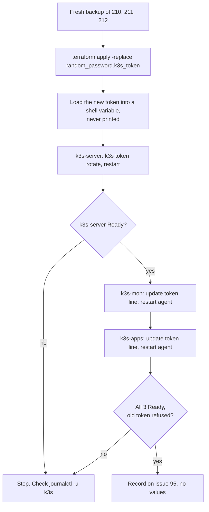

# Runbook: K3s join token rotation

> **Status, 18 October 2026:** not yet run. Set for Mon 19 Oct (#95). The infra-homelab PR that documents the Terraform side (`claude/95-rotate-k3s-token`) is not written yet. After the first real rotation, replace this page's `[CHECK]` items with what actually ran.

The join token lets a machine join the cluster. On 17 Oct, `tail` of `/etc/rancher/k3s/config.yaml` on k3s-apps printed it and it was pasted into an AI chat, so it is treated as exposed (#95). The risk is low, because the API port is not reachable from the internet (#83), but it still has to be rotated.

## The one rule

**Never print the token.** Not with `cat`, `tail`, `less`, `terraform output` or `echo`. Not in a ticket, a PR, a chat or a screenshot. To look at the config file, use:

```bash
sudo grep -v token /etc/rancher/k3s/config.yaml
```

To check the token line is present without showing it:

```bash
sudo grep -c '^token:' /etc/rancher/k3s/config.yaml      # 1
```

## Where the token lives

| Place | What to do |
|---|---|
| Terraform state, `random_password.k3s_token` (infra-homelab `terraform/proxmox/`) | Replace it, so Terraform stops reusing the old value |
| Cloud-init snippets on the host, `/var/lib/vz/snippets/k3s-k3s-*.yaml` | Rewritten by the same apply. The running VMs ignore them; they matter for rebuilds. |
| k3s-server | `k3s token rotate` |
| `token:` in `/etc/rancher/k3s/config.yaml` on k3s-mon and k3s-apps | Update by hand, restart the agent |

## Order

Server first, then the agents. An agent with the old token keeps running, but can't rejoin after a restart until it has the new one.



## Steps

Pick a quiet time, away from 01:30 to 03:00. Expect node-down alert emails if an agent stays NotReady for over 2 minutes.

1. **Back up first.** On the Proxmox host:
   ```bash
   vzdump 210 211 212 --storage internal-backup --mode snapshot --compress zstd
   ```
2. **New value in Terraform.** On the laptop, in infra-homelab `terraform/proxmox/`:
   ```bash
   terraform plan -replace=random_password.k3s_token     # read it: the token and the 3 snippets change, no VM replaced
   terraform apply -replace=random_password.k3s_token
   ```
   If the plan replaces a VM, stop and don't apply.
3. **Get the new token into a variable without printing it.** `[CHECK: how the new value is read out of Terraform without printing it, for example a sensitive output piped straight to the server; to be written in the infra-homelab PR.]` On each machine where you need it, load it hidden:
   ```bash
   read -rs NEW_TOKEN && export NEW_TOKEN
   echo ${#NEW_TOKEN}          # prints only the length
   ```
4. **Rotate on k3s-server.**
   ```bash
   sudo k3s token rotate --new-token "$NEW_TOKEN"
   sudo systemctl restart k3s
   sudo k3s kubectl get nodes
   ```
   `[CHECK: the exact k3s token rotate flags for the installed K3s version, from the K3s docs; and whether k3s-server's own config.yaml also has a token: line that needs the new value.]`
5. **Update each agent,** k3s-mon first, then k3s-apps. SSH as `ravi`:
   ```bash
   sudo cp /etc/rancher/k3s/config.yaml /etc/rancher/k3s/config.yaml.bak-95
   read -rs NEW_TOKEN && export NEW_TOKEN
   sudo sed -i "s|^token:.*|token: ${NEW_TOKEN}|" /etc/rancher/k3s/config.yaml
   unset NEW_TOKEN
   sudo grep -c '^token:' /etc/rancher/k3s/config.yaml       # 1
   sudo systemctl restart k3s-agent
   ```
   The backup file holds the old token. Delete it with `sudo shred -u /etc/rancher/k3s/config.yaml.bak-95` once the node is Ready again.
6. **Check.** On k3s-server:
   ```bash
   sudo k3s kubectl get nodes        # all 3 Ready
   ```
   Then show the old token is refused. `[CHECK: the test, either a test join with the old token or the check in the K3s docs.]`
7. **Clean up.** `unset NEW_TOKEN` in every shell. Close the terminals.

## Way back

If an agent won't come back after step 5, restore its file and restart:

```bash
sudo cp /etc/rancher/k3s/config.yaml.bak-95 /etc/rancher/k3s/config.yaml && sudo systemctl restart k3s-agent
```

This only works if the server still accepts the old token. `[CHECK: whether the server accepts the old token after rotation; if not, the way back for an agent is the new token only.]`

## Record it

On #95, in the `agent-update` format, post `kubectl get nodes` (no token in it) and the result of the old-token check. Add a row to the rotation log in [dns-terraform.md](dns-terraform.md#rotation-log). After #105, store the new value in the vault.
