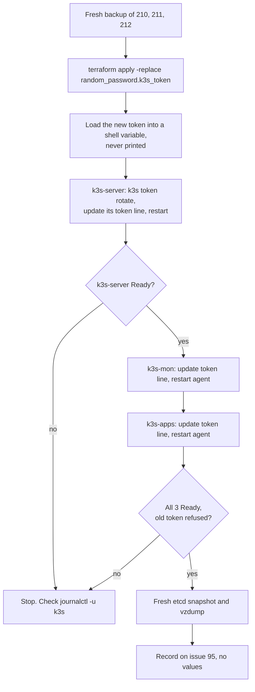

# Runbook: K3s join token rotation

> **Status, 20 October 2026:** not yet run (#95). The full steps, kept with the code, are in infra-homelab `docs/homelab-build.md`, section "Rotating the K3s join token" (infra-homelab PR #28). This page is the short version. After the first real rotation, replace the `[CHECK]` items with what actually ran.

The join token lets a machine join the cluster. On 17 Oct, `tail` of `/etc/rancher/k3s/config.yaml` on k3s-apps printed it and it was pasted into an AI chat, so it is treated as exposed (#95). The risk is low, because the API port is not reachable from the internet (#83), but it still has to be rotated.

## The one rule

**Never print the token.** Not with `cat`, `tail`, `less`, `terraform output` or `echo`. Not in a ticket, a PR, a chat or a screenshot. To look at the config file, use:

```bash
sudo grep -v token /etc/rancher/k3s/config.yaml
```

To check the token line is present without showing it:

```bash
sudo grep -cE '^"?token"?:' /etc/rancher/k3s/config.yaml      # 1
```

Terraform writes the key with quotes, `"token": "..."`, so a pattern for `^token:` matches nothing.

## Where the token lives

| Place | What to do |
|---|---|
| Terraform state, `random_password.k3s_token` (infra-homelab `terraform/proxmox/`) | Replace it, so Terraform stops reusing the old value |
| Cloud-init snippets on the host, `/var/lib/vz/snippets/k3s-k3s-*.yaml` | Rewritten by the same apply. The running VMs ignore them; they matter for rebuilds. |
| k3s-server | `k3s token rotate`, then the `token` line in its own `/etc/rancher/k3s/config.yaml` |
| The `"token":` line in `/etc/rancher/k3s/config.yaml` on k3s-mon and k3s-apps | Update by hand, restart the agent |

## Order

Server first, then the agents. An agent with the old token keeps running, but can't rejoin after a restart until it has the new one.



## Steps

Pick a quiet time, away from 01:30 to 03:00. Expect node-down alert emails if an agent stays NotReady for over 2 minutes.

**Before you start:** etcd snapshots taken before the rotation need the old token to restore (K3s docs). For the 7 days the nightly snapshots are kept, the vzdump backup from step 1 is the restore path. Step 7 takes fresh backups, so the #27 restore drill should use those.

1. **Back up first.** On the Proxmox host:
   ```bash
   vzdump 210 211 212 --storage internal-backup --mode snapshot --compress zstd
   ```
2. **New value in Terraform.** On the laptop, in infra-homelab `terraform/proxmox/`:
   ```bash
   terraform plan -replace=random_password.k3s_token -out rotate.plan   # read it: the token and the 3 snippets change, no VM changes
   terraform apply rotate.plan
   ```
   If the plan changes a VM, stop and don't apply.
3. **Copy the new token to each VM without printing it.** From the laptop, once per VM. The `k3s_token` output is sensitive; `-raw` sends it into the pipe, not to the screen:
   ```bash
   terraform output -raw k3s_token | ssh ravi@<vm> "umask 077; tr -d '\r\n' > ~/.k3s-new-token; wc -c < ~/.k3s-new-token"   # 48
   ```
4. **Rotate on k3s-server.**
   ```bash
   OLD=$(sudo sed -nE 's/^"?token"?: *"?([^"]*)"?$/\1/p' /etc/rancher/k3s/config.yaml)
   NEW=$(cat ~/.k3s-new-token)
   echo ${#OLD} ${#NEW}                                      # 48 48
   sudo k3s token rotate --token "$OLD" --new-token "$NEW"
   sudo cp -p /etc/rancher/k3s/config.yaml /root/config.yaml.bak-95
   sudo sed -i -E "s|^\"?token\"?:.*|\"token\": \"${NEW}\"|" /etc/rancher/k3s/config.yaml
   sudo systemctl restart k3s
   sudo k3s kubectl get nodes                                # k3s-server Ready
   ```
   The server's own token line must have the new value **before** the restart: the server holds the token too. If it doesn't come back, `sudo journalctl -u k3s -n 50` and fix the token line.
5. **Update each agent,** k3s-mon first, then k3s-apps. SSH as `ravi`:
   ```bash
   NEW=$(cat ~/.k3s-new-token)
   sudo cp -p /etc/rancher/k3s/config.yaml /root/config.yaml.bak-95
   sudo sed -i -E "s|^\"?token\"?:.*|\"token\": \"${NEW}\"|" /etc/rancher/k3s/config.yaml
   sudo grep -cE '^"?token"?:' /etc/rancher/k3s/config.yaml  # 1
   sudo systemctl restart k3s-agent
   ```
   Wait for Ready before the next node.
6. **Check.** On k3s-server:
   ```bash
   sudo k3s kubectl get nodes        # all 3 Ready
   printf 'user = "node:%s"\n' "$OLD" | curl -sk -o /dev/null -w 'old %{http_code}\n' -K - https://127.0.0.1:6443/v1-k3s/client-ca.crt
   printf 'user = "node:%s"\n' "$NEW" | curl -sk -o /dev/null -w 'new %{http_code}\n' -K - https://127.0.0.1:6443/v1-k3s/client-ca.crt
   ```
   Expect `old 401` and `new 200`. `[CHECK: that this endpoint checks the token. If both lines say 200, the test proves nothing; say so on #95.]`
7. **Fresh backups.** On k3s-server: `sudo k3s etcd-snapshot save --name post-rotation-95`. On the host: step 1 again.
8. **Clean up.** On every VM: `shred -u ~/.k3s-new-token; sudo shred -u /root/config.yaml.bak-95; unset OLD NEW`. On the laptop: delete `rotate.plan`, close the terminal.

## Way back

There is no way back to the old token: once rotated, it can't join anything (RKE2 and K3s share this code; RKE2's docs say the old token is invalidated). If an agent won't come back, check its token line against `~/.k3s-new-token` and restart it again. If the server won't start and the token line is right, restore all three VMs from step 1's backup; that brings back the old token, so rotate again.

## Record it

On #95, in the `agent-update` format, post `kubectl get nodes` (no token in it) and the result of the old-token check. Add a row to the rotation log in [dns-terraform.md](dns-terraform.md#rotation-log). After #105, store the new value in the vault.
