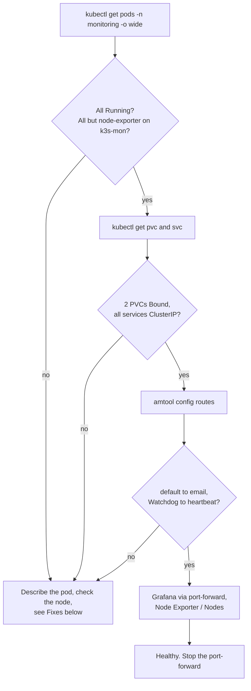

# Runbook: monitoring stack check

The monitoring stack is kube-prometheus-stack, chart 91.8.2, Helm release `monitoring` in namespace `monitoring` (#82). It runs on k3s-mon. Install, upgrade and Secret steps are in infra-homelab `docs/homelab-build.md`, sections "Monitoring stack", "Alerts by email" and "Heartbeat". This page is the health check and the day-to-day commands. It does not repeat the install.

Outside monitors (Upptime, the watch Worker) are separate: [upptime.md](upptime.md), [watch-worker.md](watch-worker.md).

## What is there

| Part | Where | Notes |
|---|---|---|
| Prometheus | k3s-mon | `local-path` volume 10 GiB, 7 days, capped at 8 GB |
| Grafana | k3s-mon | `local-path` volume 2 GiB. Reached with `port-forward` only. |
| Alertmanager | k3s-mon | Config from the Secret `alertmanager-homelab` |
| Operator, kube-state-metrics | k3s-mon | |
| node-exporter | All 3 nodes, by design | |
| Alerts | `KubeNodeNotReady`, `KubeNodeUnreachable`, `NodeExporterDown` after 2 min (#93) | Email to Ravi |
| Heartbeat | Always-firing `Watchdog` to healthchecks.io check `homelab`, about every 5 min (#97) | healthchecks.io emails when pings stop |

Nothing is exposed: no Ingress, no NodePort, no LoadBalancer.

## Health check

Run from the laptop with the homelab kubeconfig, or on k3s-server with `sudo k3s kubectl` in place of `kubectl`.



1. **Pods.**
   ```bash
   kubectl get pods -n monitoring -o wide
   ```
   All `Running`. Prometheus, Alertmanager, Grafana, the operator and kube-state-metrics on `k3s-mon`. One node-exporter on each of k3s-server, k3s-mon and k3s-apps. On 16 Oct there were 8 pods.
2. **Storage.**
   ```bash
   kubectl get pvc -n monitoring          # 2 volumes, Bound
   ```
3. **Nothing exposed.**
   ```bash
   kubectl get svc -n monitoring          # every TYPE is ClusterIP
   ```
   On 18 Oct this showed 8 services, all `ClusterIP`.
4. **Alert routes.** Prints no password:
   ```bash
   kubectl get alertmanager -n monitoring -o jsonpath='{.items[0].spec.configSecret}{"\n"}'    # alertmanager-homelab
   kubectl exec -n monitoring alertmanager-monitoring-kube-prometheus-alertmanager-0 -c alertmanager -- \
     amtool config routes --alertmanager.url=http://localhost:9093
   ```
   Expect the default route to `email`, `{alertname="Watchdog"}` to `heartbeat`, and InfoInhibitor and info to `null`.
5. **Alert rules.**
   ```bash
   kubectl get prometheusrule -n monitoring | grep node-down
   ```
6. **Heartbeat.** In healthchecks.io, the check `homelab` is green, with a last ping a few minutes ago.
7. **Grafana.** See the next section. Dashboards → **Node Exporter / Nodes** lists all three nodes with live CPU, memory and disk.

## Open Grafana (port-forward only)

```bash
kubectl port-forward -n monitoring svc/monitoring-grafana 3000:80
```

Browse to `http://localhost:3000`, user `admin`. The password is in the Secret `monitoring-grafana`, key `admin-password`, base64. Decode it on your own machine and never paste it in a ticket or chat:

```bash
kubectl get secret -n monitoring monitoring-grafana -o jsonpath="{.data.admin-password}" | base64 -d; echo
```

Rules:

- Never add an `--address` flag that listens on all interfaces. The default listens on localhost only. On 16 Oct a port-forward left running on k3s-server listened on all interfaces on port 3000 (#83).
- Stop the port-forward with Ctrl+C when you are done.
- Never add an Ingress, NodePort or LoadBalancer for Grafana. Remote access is through Tailscale.

## Fixes

| Problem | What to do |
|---|---|
| Pods `Pending` or not on k3s-mon | `kubectl describe pod -n monitoring <pod>`. Check k3s-mon is `Ready` (`kubectl get nodes`). The pods need the toleration for `bvrinfra.in/role=monitoring`. |
| Pods restarted | Compare the time with the last power cut or test. Restarts on 17 Oct matched the power cut and the failover test (#82). |
| Grafana password refused | Grafana keeps the password it first started with. Reset it to the Secret's value without printing it, with `grafana cli admin reset-admin-password` inside the Grafana pod, as on 18 Oct (#82). `[CHECK: write the exact command used on 18 Oct.]` |
| No alert email | Check step 4. Check the Gmail app password `homelab-alertmanager` still exists in the Google account. To change the address or password, follow infra-homelab `docs/homelab-build.md`, "Change the address or password later". |
| Heartbeat red | The whole homelab, or Alertmanager, may be down. Use [../playbooks/homelab-down-or-power-cut.md](../playbooks/homelab-down-or-power-cut.md). |
| `helm upgrade` times out fetching the chart | Download the chart `.tgz` first and upgrade from the file, as in infra-homelab `docs/homelab-build.md`. |

## Tests

- **Node down** (proven 17 Oct, #93). On the Proxmox host: `qm shutdown 212`, wait 5 minutes, `qm start 212`. Expect a firing email 3 to 4 minutes after the shutdown, and a resolved email within about 5 minutes of k3s-apps being Ready. Don't use `capacity-test.sh node-down` for this: it keeps the VM down only about 100 seconds.
- **Whole homelab down** (not run yet, #97). On the Proxmox host: `qm shutdown 210 211 212`, wait about 15 minutes for a DOWN email from healthchecks.io, then `qm start 210 211 212` and expect an UP email. The site falls back to Pages during this test.
- **Telegram** as a second receiver is planned (#96). Not set up yet.

## Record it

After a check or a test, comment on the related issue in the `agent-update` format from [AGENTS.md](../../AGENTS.md#report-on-the-ticket), with the commands you ran and what they showed. No passwords, addresses or ping URLs.
