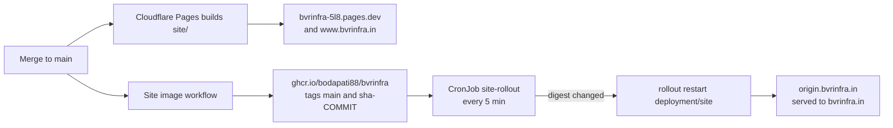

# Runbook: site deploy

A merge to `main` is the deploy. Nobody runs a deploy command for the site. There are two copies, and both update from the same commit.



## What happens after a merge

1. **Cloudflare Pages** builds `site/` from `main`. It serves `bvrinfra-5l8.pages.dev`, `www.bvrinfra.in`, and `bvrinfra.in` whenever the homelab can't answer. `[CHECK: Pages project build settings (root directory, build command) as set in the Cloudflare dashboard.]`
2. **The `Site image` workflow** (`.github/workflows/site-image.yml`) builds `site/Dockerfile` from the repo root and pushes two tags: `ghcr.io/bodapati88/bvrinfra:main` and `ghcr.io/bodapati88/bvrinfra:sha-<commit>`. The commit is baked into the page through `SITE_COMMIT_SHA`. The package is public, so the cluster pulls it without a token.
3. **The `site-rollout` CronJob** on k3s-apps (infra-homelab `apps/site/rollout-on-new-image.yaml`) runs every 5 minutes. It compares the digest of `main` on GHCR with the running pod. If they differ, it runs `kubectl -n site rollout restart deployment/site`. The rollout keeps the old pod until the new one is ready (`maxUnavailable: 0`), so there is no gap.

So the homelab copy is live within a few minutes of the image push, plus up to 5 minutes for the CronJob.

The Workers are **not** deployed by a merge. If `infra/worker/` or `infra/watch/` changed, Ravi runs `npx wrangler deploy` from that folder after the merge.

## Which version is live

The home page shows the commit it was built from, under **Last deploy**. Compare each copy with `main`:

```bash
git fetch origin && git rev-parse origin/main
curl -s https://bvrinfra.in/              | grep -oE 'bvrinfra/commit/[0-9a-f]{40}' | head -1
curl -s https://origin.bvrinfra.in/       | grep -oE 'bvrinfra/commit/[0-9a-f]{40}' | head -1
curl -s https://bvrinfra-5l8.pages.dev/   | grep -oE 'bvrinfra/commit/[0-9a-f]{40}' | head -1
curl -sI https://bvrinfra.in/ | grep -i x-served-by      # homelab or pages
```

On the cluster (on k3s-server, `kubectl` is `sudo k3s kubectl`):

```bash
kubectl -n site get pods -o wide                                   # site and cloudflared Running on k3s-apps
kubectl -n site get pods -l app=site -o jsonpath='{.items[0].status.containerStatuses[0].imageID}{"\n"}'
kubectl -n site get jobs                                           # the latest site-rollout job
kubectl -n site logs job/$(kubectl -n site get jobs -o name | tail -1 | cut -d/ -f2)
```

The job log prints `registry main:` and `running:` digests, and `rolled out <digest>` when it restarted the site.

On GitHub: Actions → **Site image** → the run for the merge commit must be green. On Cloudflare: Workers & Pages → the Pages project → Deployments. `[CHECK: the Pages project name in the dashboard.]`

## If the homelab copy is behind

1. Check the `Site image` run for the merge commit is green and pushed.
2. Read the latest `site-rollout` job log (above). `registry main: unknown` means it could not reach GHCR.
3. Force a check now instead of waiting: `kubectl -n site create job --from=cronjob/site-rollout site-rollout-manual`. `[CHECK: not yet run on this cluster.]`
4. While the homelab is behind or down, visitors still get a working site: the Worker only falls back on a timeout, a 5xx or a tunnel error. A homelab that answers with an older build is served as is.

## If a deploy is bad

Use [../playbooks/bad-deploy-or-merge.md](../playbooks/bad-deploy-or-merge.md).
