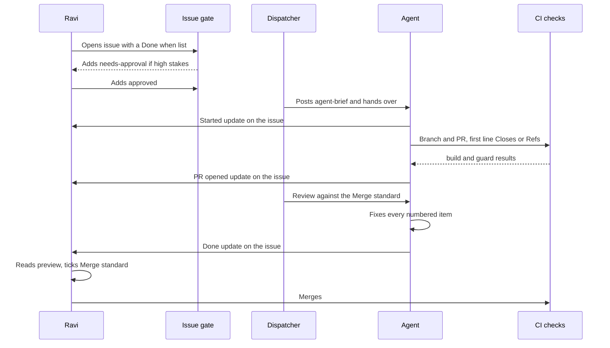

# Runbook: from ticket to merge

How a piece of work moves from a GitHub issue to `main`. The rules themselves live in [AGENTS.md](../../AGENTS.md) and [working-agreement.md](../working-agreement.md). This page is the walk-through; if the two disagree, those files win.

## The flow



## Step by step

1. **Issue.** Only issues opened by `BODAPATI88` count. The `issue-gate` workflow labels anyone else's `untrusted`, and agents ignore it. The issue needs a **Done when** list; that list is the scope.
2. **Labels.** Exactly one doing owner (`owner:claude`, `owner:gemini`, `owner:chatgpt`, `owner:ravi`), plus type, priority and size. `P0`, `P1`, `size:L`, `type:infra` and `type:security` get `needs-approval` until Ravi adds `approved`.
3. **Brief.** The dispatcher posts a comment starting `<!-- agent-brief -->`. Agents follow only briefs posted by `BODAPATI88`. If a brief and the Done-when list disagree, the Done-when list wins.
4. **Hand-over.** The dispatcher runs every hour from 10:00 to 18:00 IST, Monday to Friday. Jules starts when the issue gets the `jules` label; Codex gets a mention with the brief's prompt; Claude works it directly.
5. **Branch.** `<agent>/<issue-number>-<short-name>`, for example `jules/21-why-static` or `claude/111-playbooks-runbooks`. Never push to `main`; a ruleset blocks it.
6. **PR.** The first line of the description is `Closes #N`. Use `Refs #N` when the PR is only part of the issue, or when the issue must stay open until Ravi checks something (for example a `size:L` ticket waiting for `approved`). Mark every assumed fact `[CHECK]`.
7. **Report on the issue** at started, PR opened, blocked and done, in this format:
   ```
   <!-- agent-update -->
   **Update: <agent>, <status: started | PR opened | blocked | done>**
   - Did: <one or two lines>
   - Next: <one line>
   - Needs from Ravi: <one line, or "nothing">
   - PR: <link, or "none">
   ```
8. **Checks.** See the table below. A red `build` cannot merge.
9. **Review.** Claude reads the diff against the Done-when list and posts approve or numbered change requests. The agent answers every item on the same branch, then posts a done update.
10. **Merge.** Only Ravi merges, and only when every box of the Merge standard is ticked.

## Lanes

| Agent | Branch prefix | May change |
|---|---|---|
| Jules / Gemini | `jules/` or `gemini/` | `site/src/pages/writing/**` (new articles), `site/src/data/log.ts` |
| Codex / ChatGPT | `codex/` or `chatgpt/` | Text inside existing pages under `site/src/pages/**` |
| Claude | `claude/` | Anything, including `infra/**`, `.github/**`, `site/src/components/**` |

The `guard` check enforces the lane by branch prefix. A branch with any other prefix has no path limit, so always use the right prefix.

## The checks on a PR

| Check | Workflow | What it does |
|---|---|---|
| `build` | `site-build.yml` | `npm ci`, `npm run build`, then checks the expected pages exist in `dist/`. Required by the `main` ruleset. |
| `guard` | `pr-guard.yml` | Lane check (agent prefixes only); first line `Closes`, `Fixes` or `Refs #N` (agent prefixes only); no open `[CHECK]` in `site/src/**`; no private IP address in `site/src/**` or `docs/**` |
| `quality` | `quality.yml` | Lighthouse budgets (`site/lighthouserc.json`) and an axe accessibility scan in both themes |
| `worker`, `image` | `site-image.yml` | Tests both Workers, builds the site image. Pushes to GHCR only on `main`. |
| `check` | `terraform-check.yml` | `terraform fmt`, `init -backend=false`, `validate`. Only when `infra/terraform/**` changes. |
| HCP speculative plan | HCP Terraform | The real DNS diff. Read it; it is the review. |
| Cloudflare Pages preview | Cloudflare Pages | A preview build of the PR. Ravi opens it before merging. |

`[CHECK: which checks besides build are required in the main ruleset.]`

Run the build yourself before opening a PR:

```bash
cd site
npm ci
npm run build
```

`guard` does not block `[CHECK]` in `docs/**`, but the Merge standard does. A docs PR with an open `[CHECK]` waits until Ravi confirms or removes each one.

## Merge standard

Copied from [working-agreement.md](../working-agreement.md#merge-standard). Ravi merges only when all of these hold:

- [ ] `build`, `guard` and the Cloudflare Pages preview are green
- [ ] Claude's latest review on the current commit says **ready for Ravi to merge**
- [ ] Every item in the issue's **Done when** list is met
- [ ] No open `[CHECK]`, no invented facts, no employer or client names, IPs or costs
- [ ] The agent posted a **done** update on the issue
- [ ] Ravi opened the preview and read the changed text

## Work in other repos

Code for the homelab goes in `BODAPATI88/infra-homelab`, on a branch such as `claude/95-rotate-k3s-token`, with a PR description starting `Part of BODAPATI88/bvrinfra#N`. The dispatcher never touches that repo; only an interactive Claude session does. Agent GitHub apps are installed on this repo only.

## After merge

- Site changes go live on their own: [site-deploy.md](site-deploy.md).
- DNS changes wait for Ravi's apply: [dns-terraform.md](dns-terraform.md).
- Worker changes wait for Ravi's `npx wrangler deploy`: [../homelab-origin.md](../homelab-origin.md), [watch-worker.md](watch-worker.md).
- Homelab changes wait for Ravi to apply them on the cluster or the host.
