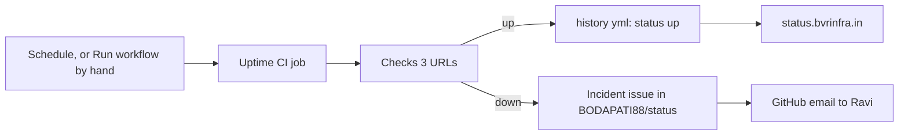

# Runbook: Upptime

Upptime is the outside monitor and the public status page. It runs on GitHub Actions in `BODAPATI88/status`, so it keeps working when the homelab is off. The page is at [status.bvrinfra.in](https://status.bvrinfra.in).

## How often it really runs

The workflow **Uptime CI** (`.github/workflows/uptime.yml`) is scheduled `*/5 * * * *`. GitHub delays and drops scheduled runs, so in practice it runs **every 2 to 4 hours**. On 17 Oct it ran 6 times, at 10:34, 13:53, 16:48, 18:53, 21:10 and 23:07 UTC (#107). An outage shorter than a couple of hours can pass unrecorded. That is why the watch Worker exists ([watch-worker.md](watch-worker.md)), and why tests start Upptime by hand.

## What it checks

From `.upptimerc.yml` in the status repo:

| Name | URL |
|---|---|
| bvrinfra.in | `https://bvrinfra.in` |
| www.bvrinfra.in | `https://www.bvrinfra.in` |
| Projects page | `https://bvrinfra.in/projects/` |

A failure opens an issue in `BODAPATI88/status`, and GitHub emails the owner. Recovery closes the issue. Results are committed to `history/*.yml` in that repo, for example `history/bvrinfra-in.yml`.



## Run it by hand

1. GitHub → `BODAPATI88/status` → **Actions** → **Uptime CI**.
2. **Run workflow** → keep the default branch → **Run workflow**.
3. Wait for the run to finish, usually a few minutes. `[CHECK: typical run time.]`
4. Check:
   - the run is green;
   - **Issues**: no new incident issue;
   - `history/bvrinfra-in.yml`: `status: up`, with a fresh time.

With a signed-in `gh` CLI, the same is:

```bash
gh workflow run uptime.yml -R BODAPATI88/status
gh run list -R BODAPATI88/status --workflow uptime.yml --limit 3
```

The default branch of the status repo is `master` (#107). `[CHECK: confirm in the repo settings.]`

## Change what it checks or says

Edit `.upptimerc.yml` in the status repo, never the workflow files. The workflows are generated and overwritten by the Upptime template update. The status page intro (`introMessage`) must say what is true: since 18 Oct it says scheduled every five minutes, every few hours in practice.

## Its token

Upptime uses the Actions secret `GH_PAT`, a fine-grained PAT for the `status` repo only (Actions, Contents, Issues, Pages, Workflows, read and write). It expires one year from 2026-10-08. Rolling it, and the log of rotations: [dns-terraform.md](dns-terraform.md#other-tokens-to-roll-yearly).

If the PAT expires, runs fail. `[CHECK: what a failed run looks like when GH_PAT has expired, and whether GitHub emails about it.]`

## The status page

GitHub Pages serves the status page from the status repo. DNS: `status` is a CNAME to `bodapati88.github.io`, **not proxied**, because GitHub Pages needs that for HTTPS ([domain.md](domain.md)). The domain is verified with GitHub Pages (#20).

## When it reports down

Use [../playbooks/monitor-alert.md](../playbooks/monitor-alert.md). Remember that the alert may be hours old: check the run's time before acting.
